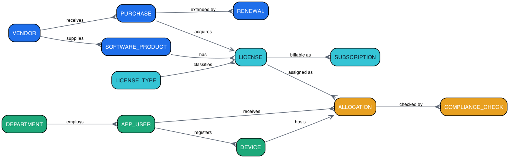

# Software License & Subscription Management System

A database project that keeps track of every software license a university owns — what was bought, who is using it, when it expires, and what it costs to renew. Built with MySQL and a Streamlit web UI.

**Student:** Jampana Naga Satya Sai Rishvarma · `25WU0102105` · B.Tech CSE (AI & ML), Woxsen University

---

## ER Diagram

One purchase buys seats of a product from a vendor; each seat is handed to one user (usually on one device); renewals extend validity; compliance checks audit every active allocation.



| Module | Tables |
|---|---|
| Procurement | VENDOR, SOFTWARE_PRODUCT, PURCHASE, RENEWAL |
| Licensing | LICENSE, LICENSE_TYPE, SUBSCRIPTION |
| Organization | DEPARTMENT, APP_USER, DEVICE |
| Compliance | ALLOCATION, COMPLIANCE_CHECK |

---

## What It Does

- **Dashboard** — licenses, seats in use vs free, expiry monitor (OK / WARNING / CRITICAL / EXPIRED), vendor spend chart
- **Allocate / Reclaim** — give a seat to a user, take it back; seats can never exceed what was purchased (enforced by DB triggers)
- **Purchases & Renewals** — record a purchase, renew a license, and extend its validity in one step
- **Compliance** — one click flags every problem: expired license in use, user inactive, no device assigned; every check is saved as an audit record
- **Manage Data** — add, edit and delete rows in all 12 tables with dropdowns for IDs instead of typing them

The database itself enforces the rules (unique license keys, seat limits, no allocation on expired licenses), so bad data can't get in even through other tools.

---

## How to Run It

### 1. Just want to see the app? (no setup)

```bash
pip install -r requirements.txt
streamlit run app.py
```

This uses the bundled demo database (`data/app.db`) — no server needed.

### 2. Run it on MySQL (the real thing)

Build the database in order:

```bash
mysql -u root -p < sql/01_schema.sql
mysql -u root -p < sql/02_seed.sql
mysql -u root -p < sql/03_views_reports.sql
mysql -u root -p < sql/04_procedures.sql
mysql -u root -p license_mgmt < sql/05_demo_queries.sql
```

Then point the app at it:

```bash
export LM_DB_HOST=127.0.0.1 LM_DB_USER=root LM_DB_PASSWORD=YOUR_PASSWORD
streamlit run app.py
```

Try this once the app is up: **Dashboard** shows expiry bands → go to **Purchases & Renewals**, renew an expired license → dashboard shows it as ACTIVE again.

---

## 🎥 Demo Video

- `Final_presentation_demo_video.mp4` — full walkthrough (larger file)
- `Final_presentation_demo_video_small.mp4` — smaller version, same content

Both are in this repo root.

## 📊 Presentations

| File | Content |
|---|---|
| `ppt_review1.pptx` | Review 1 — problem, scope, requirements, ER model, plan |
| `ppt_review2.pptx` | Review 2 — finalized design, implementation progress, prototype demo |
| `ppt_review3.pptx` | Review 3 — final demo, app features & screenshots, documentation, tests |

`presentation_script_review3.md` has a short speaking script for Review 3.

---

## Project Layout

```
├── app.py, crud.py, db.py        # Streamlit UI + DB access layer
├── sql/                          # 01–05 build scripts + README with details
├── scripts/sqlite_demo.sql       # demo-mirror generator (same schema & rules)
├── data/app.db                   # demo database used when MySQL isn't set up
├── screenshots/                  # live captures of the app
├── docs/er_diagram.png           # the diagram above
├── make_er_diagram.py            # regenerates the diagram
├── make_ppts.py                  # regenerates both review decks
└── ppt_review1/2/3.pptx          # presentations
```
